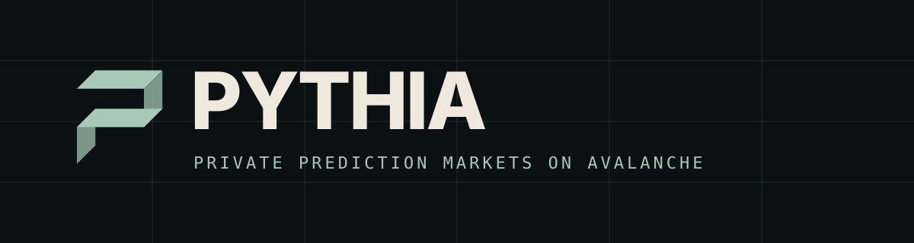
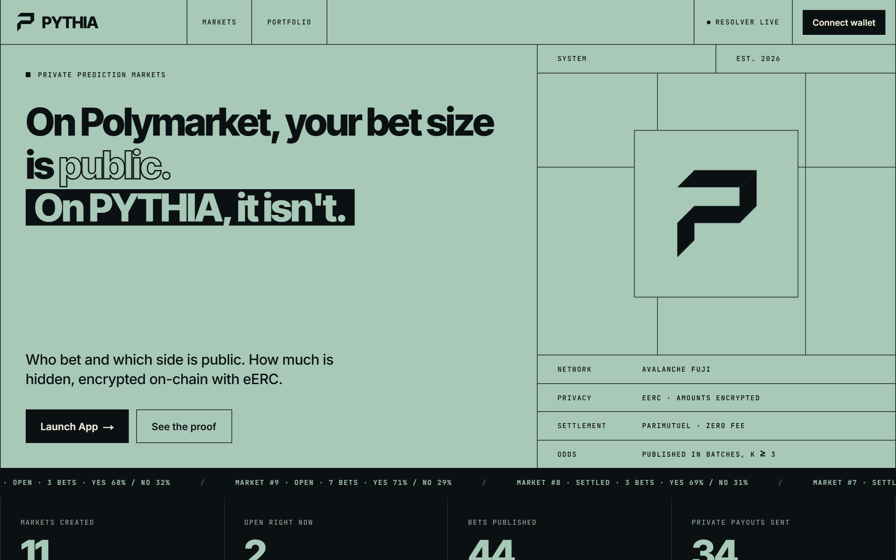
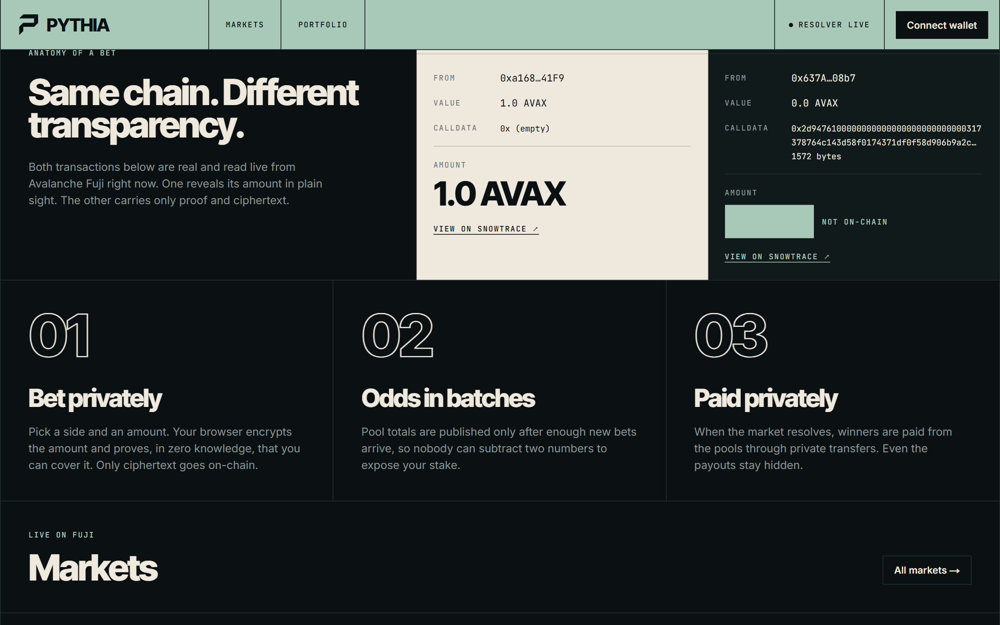
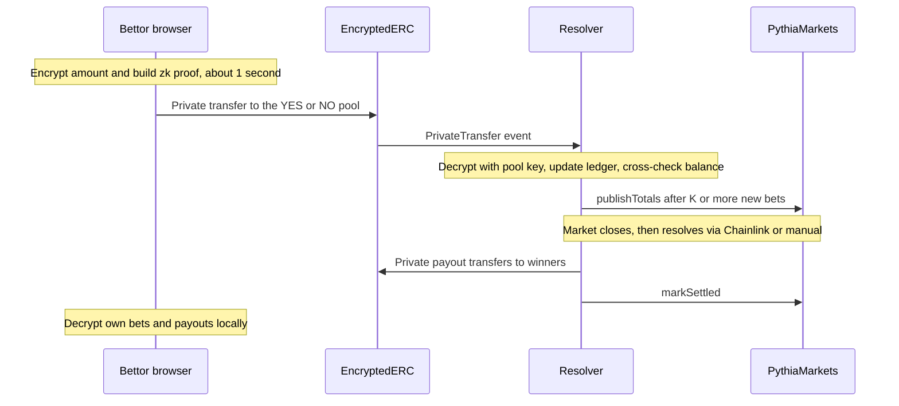
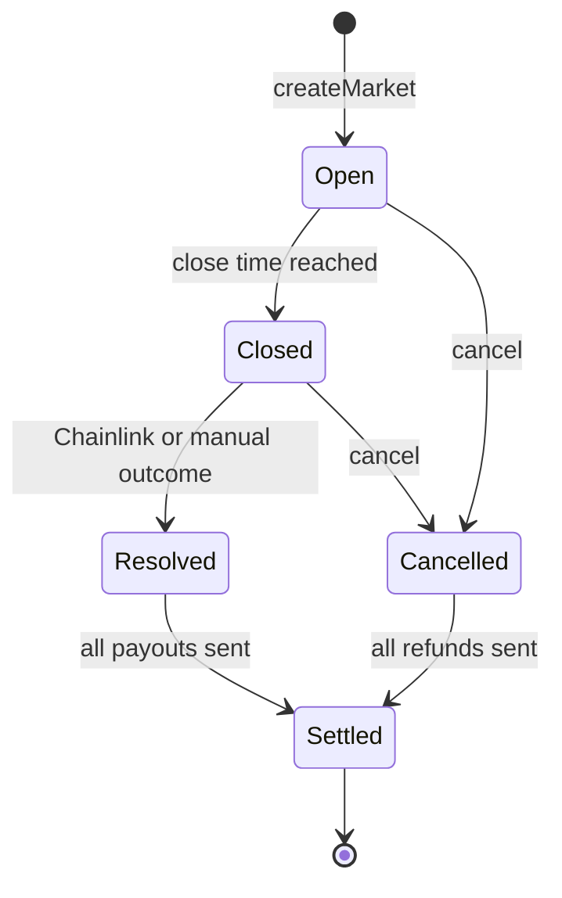
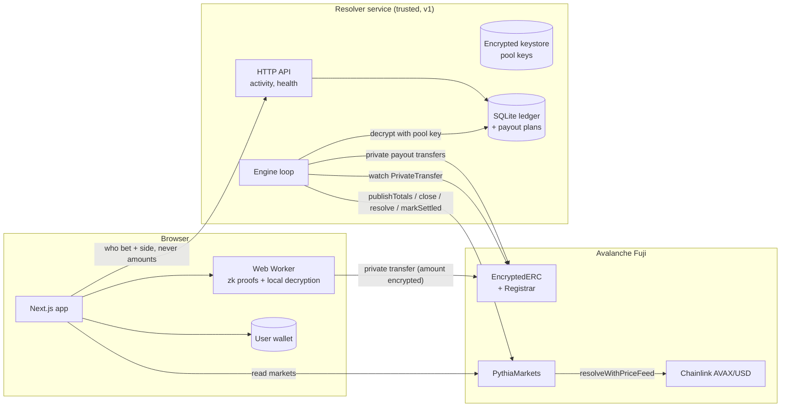

<p align="center">
  
</p>

<p align="center">
  <b>On Polymarket, your bet size is public. On PYTHIA, it isn't.</b><br>
  Who bet and which side is public. <b>How much</b> is encrypted on-chain with <a href="https://github.com/ava-labs/EncryptedERC">eERC</a>.
</p>

<p align="center">
  
  
  
  
</p>

<p align="center">
  <a href="https://pythia-markets.vercel.app"><b>Live app</b></a> ·
  <a href="#how-a-bet-works">How it works</a> ·
  <a href="#run-it-locally">Run it</a> ·
  <a href="#trust-model-v1-honest">Trust model</a> ·
  <a href="docs/DEPLOYMENTS.md">On-chain proof</a>
</p>

---

## The problem

Public prediction markets leak everything. Every wallet's position size is visible, so whales get
tracked and copy-traded, informed traders can't build a position without moving the market against
themselves, and anyone can see exactly how much you staked. Hiding amounts is hard because a market
needs *some* public numbers (odds) to work at all.

**PYTHIA hides the one number that hurts to leak, the stake, and keeps the rest of the market public.**

| | Typical on-chain prediction market | PYTHIA |
| --- | :---: | :---: |
| Who bet | public | public |
| Which side | public | public |
| **How much** | **public** | **encrypted** |
| Odds | live, every bet | in batches of K bets or more |
| Payout amounts | public | encrypted (private transfers) |
| Your own history | read from the chain | decrypted locally, in your browser |

## See it

<table>
  <tr>
    <td width="50%"><br><sub><b>Home.</b> The pitch, live market ticker and on-chain stats.</sub></td>
    <td width="50%"><br><sub><b>Proof, not promises.</b> A normal transfer shows its amount; a PYTHIA bet carries only proof and ciphertext.</sub></td>
  </tr>
  <tr>
    <td width="50%"><br><sub><b>Markets.</b> Real markets on Fuji with batched odds.</sub></td>
    <td width="50%"><br><sub><b>Bet panel.</b> Pick a side and an amount; it is encrypted before it leaves your browser.</sub></td>
  </tr>
  <tr>
    <td colspan="2"><br><sub><b>Settled market.</b> Resolved, and every winner paid with a private transfer.</sub></td>
  </tr>
</table>

## How a bet works



1. **Pools.** Each market has a YES pool and a NO pool: fresh accounts registered on the eERC
   Registrar. The resolver service holds their keys.
2. **Bet = private transfer.** The browser encrypts the amount and proves in zero knowledge
   (Groth16) that the bettor can cover it, then sends an eERC `transfer` to the pool of the chosen
   side. On-chain you see the sender, the pool (which is the side) and ciphertext. Never the amount.
3. **Batched odds.** eERC adds encrypted stakes homomorphically, so the resolver can decrypt a
   pool's total. It publishes totals only after **at least K new bets** (K = 3 by default, enforced
   by the contract), so nobody can subtract two published totals to isolate one stake. One final
   publish is allowed at close.
4. **Cross-check.** Before every publish and every payout, the resolver compares its bet ledger
   with the decrypted on-chain balance of each pool. A mismatch halts the market instead of paying.
5. **Resolution.** Price-feed markets resolve from a Chainlink feed (with a staleness check);
   manual markets are resolved by the resolver.
6. **Private payouts.** Parimutuel and zero fee: the winning side gets its stake back plus a
   pro-rata share of the losing pool (rounding dust goes to the last winner, so pools end at exactly
   zero). Invalid and cancelled markets refund exact stakes. Payouts are crash-safe: restarting
   mid-payout never pays twice.
7. **Your portfolio is yours.** The browser decrypts *your own* transfer ciphertexts with *your* key.
   Nothing leaves the browser.

### Market lifecycle



### Who can see what

| Observer | Wallet and side | Stake size | Pool totals | Payout size |
| --- | :---: | :---: | :---: | :---: |
| Anyone watching the chain | yes | **no** | only batched | **no** |
| Other users in the app | yes | **no** | only batched | **no** |
| The bettor themself | yes | yes (local decryption) | only batched | yes (local decryption) |
| The resolver (v1) | yes | yes | yes | yes |
| The eERC auditor (v1: the deployer) | yes | yes | yes | yes |

## Architecture



| Package | What it is |
| --- | --- |
| [`contracts/`](contracts) | `PythiaMarkets.sol` with Hardhat tests (70) and deploy scripts |
| [`packages/eerc-core/`](packages/eerc-core) | eERC keys, register / deposit / transfer / withdraw, local decryption (Node and browser) |
| [`resolver/`](resolver) | Keystore, pool creation, ledger, odds publishing, resolution, payouts, HTTP API (30 tests) |
| [`frontend/`](frontend) | Next.js 14 app: markets, bet flow with Web Worker proofs, portfolio, admin |
| [`docs/`](docs) | Deployments, demo flow, test checklist, mainnet readiness |

## Trust model (v1, honest)

The resolver is **trusted for custody and settlement**.

- It holds the pool accounts' private keys and eERC decryption keys. It can therefore **see every
  individual stake**, decide manual outcomes, withhold or misdirect payouts, and publish incorrect
  totals. Nothing on-chain lets users verify totals or payouts yet.
- The eERC **auditor** (currently the deployer address) can decrypt every transfer amount.
- Privacy therefore holds against **everyone watching the chain**, not against the resolver or the auditor.
- The deployed circuits use proving keys from `eerc-backend-converter`'s local setup (no multi-party
  ceremony). Fine for a testnet demo, not acceptable for real funds.
- Nothing on-chain rejects a bet after `closeTime`. The resolver treats late bets as void and refunds them.

**Roadmap**
1. Threshold-shared pool keys (no single custodian) and a threshold auditor.
2. Zero-knowledge decryption and correctness proofs, so users can verify published totals and payouts.
3. Mainnet: see [docs/MAINNET_READINESS.md](docs/MAINNET_READINESS.md) (audit, a real trusted setup or
   Avalanche's audited eERC deployment, multisig ownership, KMS/HSM keys, legal review).

## Run it locally

Requirements: Node 20 or newer (tested on 24), npm 10 or newer, about 1 GB of disk. On Windows use WSL.

```bash
git clone https://github.com/nisargpatel7042lva/pythia.git && cd pythia
npm install
cp .env.example .env        # then fill in the keys below
npm run build:core          # builds @pythia/eerc-core (needed by resolver and frontend)

# tests
npm test -w @pythia/contracts      # 70 contract tests (local Hardhat network)
npm run test:resolver              # 30 resolver tests
npm run build:frontend             # type-checks and builds the app
```

Fill in `.env` (never commit it):

| Variable | Purpose |
| --- | --- |
| `DEPLOYER_PRIVATE_KEY` | PythiaMarkets owner (creates markets). Needs Fuji AVAX |
| `RESOLVER_PRIVATE_KEY` / `RESOLVER_ADDRESS` | The resolver's account. Needs Fuji AVAX (it funds the pools' gas) |
| `POOL_KEYSTORE_PASSPHRASE` | 12+ characters; encrypts pool keys at rest |
| `PYTHIA_MARKETS_ADDRESS` and `NEXT_PUBLIC_*` | Already set to the Fuji deployment in `.env.example` |

Fuji AVAX: <https://core.app/tools/testnet-faucet/?subnet=c&token=c>. Fuji USDC: <https://faucet.circle.com>.

**Start it**

```bash
npm run resolver                     # resolver service + API on :8787
npm run dev -w @pythia/frontend      # app on :3000
```

**Create a market** (pools are created and registered automatically), then resolve it:

```bash
cd resolver
npx tsx scripts/createMarket.ts --type pricefeed --direction above --close-in 20
npx tsx scripts/createMarket.ts --type manual --question "..." --category x --close-in 60
cd .. && npm run resolve -- <marketId> <yes|no|invalid>      # manual markets
```

You can also create markets from the **/admin** page by connecting the owner wallet. To bet from a
script, set `BETTOR_PRIVATE_KEY_1/2` and run
`npx tsx scripts/placeBet.ts --wallet 1 --market 3 --side yes --amount 1.50`.

To bet in the app you need an eERC-registered wallet. The app registers you on your first bet, and
shields USDC if your encrypted balance is short (that needs Fuji USDC).

Deploy the resolver as a long-running service with the included [`Dockerfile`](Dockerfile) and
[`fly.toml`](fly.toml). It needs a persistent volume for the keystore and ledger.

## On-chain evidence

Contracts, a private bet next to a plain transfer, and full market lifecycles (create, batched
odds, close, resolve, private payouts, settle) with Snowtrace links are in
[docs/DEPLOYMENTS.md](docs/DEPLOYMENTS.md). Main contract:
[PythiaMarkets on Fuji](https://testnet.snowtrace.io/address/0xe21D7327eAd6E53AF7549Bd82942C03DF8c7eF44#code).

Every market, bet, odds update and payout in the app is a real Fuji testnet transaction, not mock
data. The seed bets came from two of our own test wallets and the money is testnet USDC with no value.

## Docs

| Doc | What it is |
| --- | --- |
| [docs/DEPLOYMENTS.md](docs/DEPLOYMENTS.md) | Contract addresses and lifecycle transactions |
| [docs/DEMO_FLOW.md](docs/DEMO_FLOW.md) | Shot-by-shot flow for a screen recording |
| [docs/TESTING.md](docs/TESTING.md) | Manual test checklist |
| [docs/MAINNET_READINESS.md](docs/MAINNET_READINESS.md) | What must change before real funds |

## What is reused and what is new

**Reused from the PHANTOM project and the eERC backend (not rewritten)**
- The deployed eERC converter stack on Fuji (EncryptedERC, Registrar, five Groth16 verifiers,
  BabyJubJub library).
- Circuit artifacts (`register`, `transfer`, `withdraw` wasm and zkey) and the EncryptedERC and
  Registrar ABIs, copied byte for byte.
- PHANTOM's eERC key-derivation findings and its use of `@avalabs/ac-eerc-sdk`. PHANTOM's UI was not reused.

**Built during this Speedrun**
- `PythiaMarkets.sol`, its 70 tests, deployment and Snowtrace verification.
- Everything in `resolver/`: encrypted keystore, pool creation, bet ledger (decrypting receiver
  ciphertexts from calldata), batched publishing with ledger/chain cross-checks, resolution,
  parimutuel payout math, crash-safe payout executor, HTTP API, 30 tests.
- `packages/eerc-core` as a Node and browser package, with local decryption of one's own transfers
  and key-scheme resolution.
- The whole frontend: design system, wallet layer, Web Worker proof pipeline, bet flow, portfolio
  (local decryption), admin and edge-case handling.

## AI tools used

Built with **Claude Code** (Anthropic's CLI agent) as a pair-programming agent: it wrote most of
the code, ran the tests, deployed to Fuji and drove the browser for end-to-end checks, under human
direction and review. All on-chain results in this repo come from real transactions that were
executed and verified, not simulated.

## Known limitations

- Testnet only, unaudited, and the resolver is a single trusted party (see the trust model).
- The public Fuji RPC is slow, rate-limits, and caps `eth_getLogs` at 100 blocks per call. The
  resolver shrinks its log window automatically, saves ledger progress after every chunk, and the
  portfolio uses the resolver's index instead of scanning logs. After downtime the ledger needs a
  while to catch up; use a dedicated RPC for anything serious.
- The app's resolver-backed features (activity feed, portfolio index, admin pool creation) need the
  resolver service to be running and reachable.
