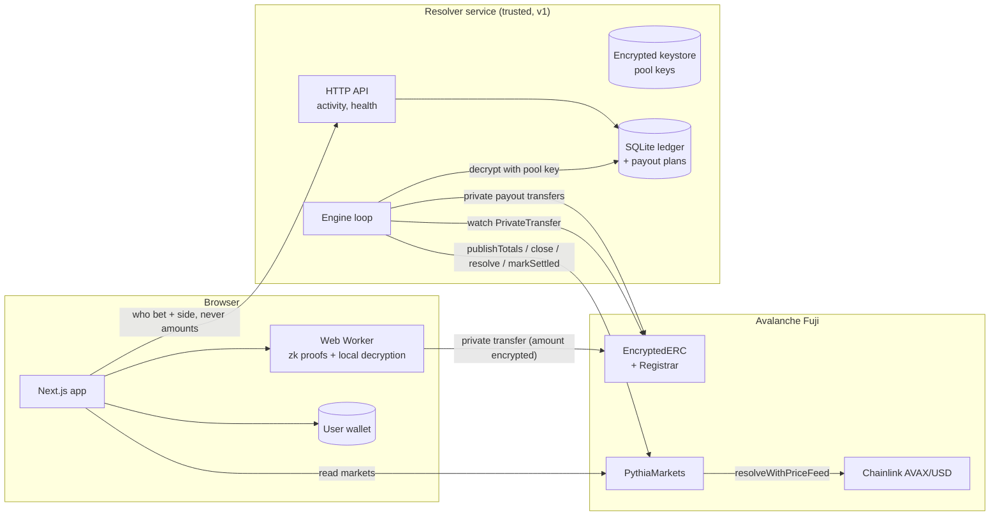

# PYTHIA

**Private prediction markets on Avalanche.** On Polymarket, your bet size is public. On PYTHIA, it isn't.

Who bet and which side is public. **How much is hidden**, encrypted on-chain with
[eERC](https://github.com/ava-labs/EncryptedERC) (Avalanche's Encrypted ERC).

Status: working end to end on **Avalanche Fuji testnet** (chain id 43113). Not audited. Not on mainnet.

## The problem

Public prediction markets leak everything: every wallet's position size is visible, so whales
get tracked and copy-traded, informed traders can't build a position without moving the market
against themselves, and anyone can see exactly how much you staked. Hiding amounts without
hiding the market itself is hard, because a market needs *some* public numbers (odds) to work.

## How it works

1. **Pools.** Every market has a YES pool account and a NO pool account: fresh EOAs registered on
   the eERC Registrar. The resolver service holds their keys.
2. **Bet = private transfer.** A bettor encrypts the amount in their browser, proves in zero
   knowledge (Groth16, in a Web Worker) that they can cover it, and sends an eERC `transfer` to
   the pool of their chosen side. On-chain: sender, pool (= side), and ciphertext. Never the amount.
3. **Batched odds.** eERC adds encrypted stakes homomorphically, and the resolver can decrypt a
   pool's total. It publishes totals to `PythiaMarkets` **only when at least K new bets** have
   arrived (K = 3 by default, enforced by the contract), so nobody can difference two published
   totals to isolate one bettor's stake. One final publish is allowed at close.
4. **Cross-check.** Before every publish and every payout the resolver compares its bet ledger
   with the decrypted on-chain balance of each pool. A mismatch halts the market instead of paying.
5. **Resolution.** Price-feed markets resolve from a Chainlink feed (staleness-checked); manual
   markets are resolved by the resolver.
6. **Private payouts.** Parimutuel, zero fee: the winning pool returns each winner's stake and
   the losing pool pays shares pro rata (rounding dust to the last winner, so pools end at
   exactly zero). Invalid and cancelled markets refund exact stakes. Payouts are private transfers
   too, and are crash-safe: restarting mid-payout never double pays.
7. **Your portfolio is yours.** The browser decrypts *your own* transfer ciphertexts with *your*
   key (nothing leaves the browser) to show what you staked and were paid.

## Architecture



| Package | What it is |
| --- | --- |
| `contracts/` | `PythiaMarkets.sol` (Hardhat, 70 tests) |
| `packages/eerc-core/` | eERC keys, register/deposit/transfer/withdraw, local decryption (Node + browser) |
| `resolver/` | Keystore, pool creation, ledger, odds publishing, resolution, payouts, HTTP API (29 tests) |
| `frontend/` | Next.js 14 app: markets, bet flow with Web Worker proofs, portfolio, admin |

## Trust model (v1, honest)

The resolver is **trusted for custody and settlement**.

- It holds the pool accounts' private keys and eERC decryption keys. It can therefore **see every
  individual stake** (it decrypts each incoming transfer), decide manual outcomes, withhold or
  misdirect payouts, and publish incorrect totals. Nothing on-chain lets users verify totals or
  payouts yet.
- The eERC **auditor** (currently the deployer address) can decrypt every transfer amount.
- Privacy therefore holds against **everyone watching the chain**, not against the resolver or the
  auditor.
- The deployed circuits use the proving keys from `eerc-backend-converter`'s local setup (no
  multi-party ceremony). Fine for a testnet demo; not acceptable for real funds.
- Nothing on-chain rejects a bet after `closeTime`. The resolver treats late bets as void and
  refunds them.

**Roadmap**
1. Threshold-shared pool keys (no single custodian) and a threshold auditor.
2. Zero-knowledge decryption/correctness proofs so users can verify published totals and payouts.
3. Mainnet: see [MAINNET_READINESS.md](MAINNET_READINESS.md) (audit, real trusted-setup/Avalanche's
   audited eERC deployment, multisig ownership, KMS/HSM keys, legal review).

## Setup (from a fresh clone)

Requirements: Node 20+ (tested on 24), npm 10+, ~1 GB disk. On Windows use WSL.

```bash
git clone https://github.com/nisargpatel7042lva/pythia.git && cd pythia
npm install
cp .env.example .env        # then fill in the keys below
npm run build:core          # builds @pythia/eerc-core (needed by resolver and frontend)

# tests
npm test -w @pythia/contracts      # 70 contract tests (local Hardhat network)
npm run test:resolver              # 29 resolver tests
npm run build:frontend             # type-checks and builds the app
```

Fill in `.env` (never commit it):

| Variable | Purpose |
| --- | --- |
| `DEPLOYER_PRIVATE_KEY` | PythiaMarkets owner (creates markets). Needs Fuji AVAX |
| `RESOLVER_PRIVATE_KEY` / `RESOLVER_ADDRESS` | The resolver's EOA. Needs Fuji AVAX (funds pools' gas) |
| `POOL_KEYSTORE_PASSPHRASE` | 12+ chars; encrypts pool keys at rest |
| `PYTHIA_MARKETS_ADDRESS` + `NEXT_PUBLIC_*` | Already set to the Fuji deployment in `.env.example` |

Fuji AVAX: <https://core.app/tools/testnet-faucet/?subnet=c&token=c>. Fuji USDC: <https://faucet.circle.com>.

**Run it**

```bash
npm run resolver                     # resolver service + API on :8787
npm run dev -w @pythia/frontend      # app on :3000   (or: npm run build:frontend && npm start -w @pythia/frontend)
```

Create a market (pools are created and registered automatically), then bet:

```bash
cd resolver
npx tsx scripts/createMarket.ts --type pricefeed --direction above --close-in 20
npx tsx scripts/createMarket.ts --type manual --question "..." --category x --close-in 60
npm run resolve -- <marketId> <yes|no|invalid>       # manual markets, from the repo root
```

Or use the **/admin** page (connect the owner wallet) to create markets. To bet from scripts,
set `BETTOR_PRIVATE_KEY_1/2` and run `npx tsx scripts/placeBet.ts --wallet 1 --market 3 --side yes --amount 1.50`.

The deployer wallet (`0x637A…08b7`) is the eERC **auditor** of the deployed contracts. To bet you
need an eERC-registered wallet: the app registers you on your first bet, and shields USDC if your
encrypted balance is short (you need Fuji USDC for that).

## Deployments and links (Avalanche Fuji)

| What | Link |
| --- | --- |
| PythiaMarkets (verified) | [0xe21D…ef44](https://testnet.snowtrace.io/address/0xe21D7327eAd6E53AF7549Bd82942C03DF8c7eF44#code) |
| EncryptedERC (converter) | [0xFd9E…63D8](https://testnet.snowtrace.io/address/0xFd9E9E078341f18bA29c14404D17D2f7ef1d63D8) |
| Registrar | [0x281D…E6c9](https://testnet.snowtrace.io/address/0x281D95Fbe23b4Ec33EcF6d4e174F57AA2A0bE6c9) |
| Fuji USDC (wrapped token) | [0x5425…1Bc65](https://testnet.snowtrace.io/address/0x5425890298aed601595a70AB815c96711a31Bc65) |
| Chainlink AVAX/USD feed | [0x5498…06aD](https://testnet.snowtrace.io/address/0x5498BB86BC934c8D34FDA08E81D444153d0D06aD) |
| Transfer / Registration / Withdraw verifiers | [0x73eC…A403](https://testnet.snowtrace.io/address/0x73eC5bC3aABBda8D1d57A9077E3e0AC7905eA403) / [0x104A…AAB6](https://testnet.snowtrace.io/address/0x104A97a3f139ccC316591BF8AFcFfC90b8e3AAB6) / [0x4b8D…fDB0](https://testnet.snowtrace.io/address/0x4b8Da05B98650348312178Deaf9cFcd76637fDB0) |

**A private bet** (note: native value 0, calldata is proof + ciphertext, no amount anywhere):
[0xad1b97…31c9](https://testnet.snowtrace.io/tx/0xad1b973a3982a55955e07b6b4e3093ed9ed7d04a6768d1dd03dbd98bd30b31c9).
For contrast, a plain transfer shows its amount in the Value field:
[1 AVAX](https://testnet.snowtrace.io/tx/0xc39293588097a5624cffdbfaf85e491bca51cf3a305f88f39f2e7fbae748b2ca).

**A full manual-market lifecycle (market 2, settled with private payouts)**

| Step | Tx |
| --- | --- |
| Market created | [0x2839c8…a5059](https://testnet.snowtrace.io/tx/0x2839c85f4434c8a1c39e674310b280299cc08814a8379cfe63d9ce688f2a5059) |
| Batched odds published (3 bets) | [0x3ad051…c4a](https://testnet.snowtrace.io/tx/0x3ad051f0a51d064ae508af38c4072b8ef05d12063caa045c587dc71690e09c4a) |
| Closed | [0xc74e1e…d0a](https://testnet.snowtrace.io/tx/0xc74e1ea545e7187659c6f9ceb9416320aa34acb39c89e7426f2a0cc2b7323d0a) |
| Final publish (5 bets) | [0xb16e19…6e5](https://testnet.snowtrace.io/tx/0xb16e19ad6f8bb34c08d123801a00a5115bf45827fc82946abe9037e8ee1486e5) |
| Resolved YES | [0xd248d2…642](https://testnet.snowtrace.io/tx/0xd248d21ae3aaba512f97e236b6f6e10fcb9c4fbcd04cbfb2fd013ddbd056f642) |
| Payouts (4 private transfers) | [1](https://testnet.snowtrace.io/tx/0x2f8038835f85b896770bf8794f17f37e532ce5f86190d68378d7bc30bb04a617) · [2](https://testnet.snowtrace.io/tx/0x8d42f0fe23293d5809839c7cfe1ed4362d5b5262c7b9058b91dcf121b56c1ed8) · [3](https://testnet.snowtrace.io/tx/0x8562f68ee45aa44891caa0ef93499ec61ce063a9d626cc34e925e61b9739f6f5) · [4](https://testnet.snowtrace.io/tx/0x465419a94464209cdc1059697710e4fa6c6ff89b4d83bae3225196e808615bba) |
| Marked Settled | [0xeeddd3…fd58](https://testnet.snowtrace.io/tx/0xeeddd33d56df2a670617343ba68b84e4635e59cd55553f0c263fa208eea9fd58) |

Payouts 3 and 4 survived two forced process kills (one mid-proof, one right after broadcast).
Market 4 is a **price-feed** lifecycle, run end to end without any manual step: closed
([tx](https://testnet.snowtrace.io/tx/0x0788ed49aacf34bcf2a2f2dcf51eee9f8947e63dfbb77579f9c607f18f614aef)),
resolved from Chainlink ([tx](https://testnet.snowtrace.io/tx/0x49eb5cbba7d5f6e2ed2940832cb903699a0fc5bbf17ba9019b5cfd4a1b037297)),
paid out in 4 private transfers
([1](https://testnet.snowtrace.io/tx/0xe4f01f891404a6e371f62e1b0b15dd25efe48d765a0c640763612c3d437ee785) ·
[2](https://testnet.snowtrace.io/tx/0xfa7d4e5caab1945193610678dbff403e7c2938d0361e068918c73958ab1fba44) ·
[3](https://testnet.snowtrace.io/tx/0x3a0036a7a99609333191185aedea37902f0394380046c872d96e8c601cd4f970) ·
[4](https://testnet.snowtrace.io/tx/0x3bd536286e1c1efb0d3dfdcefb6e642739c34f989dfe275e1817d301e4049721)),
then [marked Settled](https://testnet.snowtrace.io/tx/0xcbd1bad6776a70c57359c39078c27c5fc1a641eb0a92233274c906cbbbaa08f0).
Market 1 shows the cancel-and-refund path ([settled](https://testnet.snowtrace.io/tx/0x5e7b1832b3ec49a0c6f2aee687e36bf855b3e48867f88987af93a01153f57872)).

## About the demo data

Every market, bet, odds update and payout shown in the app is a **real transaction on Avalanche Fuji testnet** (links above), not mock data. They were created by the team with the repo's own scripts and UI: two funded test wallets placed the seed bets through the same private-transfer flow a user goes through (`resolver/scripts/placeBet.ts`), and the resolver service published odds, resolved markets and paid out on its own. The money is testnet USDC with no value, the questions are demo questions, and the bettors are our test wallets, not independent users.

## Pre-existing work vs built during this Speedrun

**Came from PHANTOM / the eERC backend (reused, not rewritten)**
- The deployed eERC converter stack on Fuji (EncryptedERC, Registrar, five Groth16 verifiers,
  BabyJubJub library), deployed earlier from `eerc-backend-converter`.
- Circuit artifacts (`register`, `transfer`, `withdraw` wasm + zkey) and the EncryptedERC / Registrar
  ABIs, copied byte for byte.
- PHANTOM's eERC key-derivation findings (`i0()` scheme vs the SDK's own) and its use of
  `@avalabs/ac-eerc-sdk`. PHANTOM's UI was **not** reused.

**Built during this Speedrun**
- `PythiaMarkets.sol` + 70 tests, deployment, Snowtrace verification.
- Everything in `resolver/`: encrypted keystore, pool creation, bet ledger (decrypting receiver
  ciphertexts from calldata), batched publishing with ledger/chain cross-checks, resolution,
  parimutuel payout math, crash-safe payout executor, HTTP API, 29 tests.
- `packages/eerc-core` as a Node + browser package, local decryption of one's own transfers
  (discrete-log search), key-scheme resolution.
- The entire frontend: design system, wallet layer, Web Worker proof pipeline, bet flow, portfolio
  (local decryption), admin, edge-case handling.

## AI tools used

Built with **Claude Code** (Anthropic's CLI agent, Claude Sonnet 5.5) as a pair-programming agent:
it wrote most of the code, ran the tests, deployed to Fuji and drove the browser for end-to-end
checks, under human direction and review. All on-chain results in this README come from real
transactions that were executed and verified, not simulated.

## Known limitations

- Testnet only; unaudited; the resolver is a single trusted party (see Trust model).
- The public Fuji RPC is slow, rate-limits, and currently caps eth_getLogs at 100 blocks per call. The resolver shrinks its log window automatically, saves ledger progress after every chunk, and the portfolio uses the resolver index instead of scanning logs. After downtime the ledger needs a while to catch up; use a dedicated RPC for anything serious.
- The built-in test wallet used in development is not part of the product.
